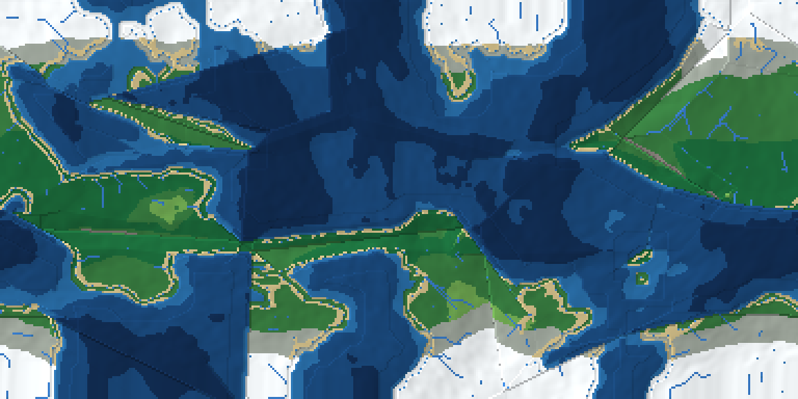

# Реверс четырёх генераторов континентов

_2026-10-14. Владелец прислал четыре репозитория; задача — разобрать все
и использовать. Код ни одного из них копировать нельзя (см. лицензии),
поэтому разобран **конвейер** каждого, а реализация написана с нуля
в `src/gen/continent.js` на общеизвестных приёмах._

## Что нашли в каждом

### 1. spectrum-art/Continent-Generator — WebGPU/WGSL + Rust/WASM
- Сетка 2048×1024, полный детерминизм от u32-seed, мультипроходные compute-шейдеры.
- Идеология «plates first»: domain-warped Voronoi → плиты с типами коры и
  скоростями → land mask из континентальных плит → стресс границ
  (normal/shear, класс коры) → JFA (jump flooding) поле расстояний до разломов →
  возвышение из стресса + древние хребты + плюмы → shaded relief.
- Лицензии нет. WebGPU есть не во всех браузерах, сборка требует Rust/wasm-pack.
- **Взято:** архитектуру целиком (плиты → стресс → горы/рифты → рельеф),
  JFA заменён честным BFS (сетка 384×192, так проще и точнее).

### 2. blslade-neumont/procedural-continent-generator — TypeScript, 2017
- Учебный скелет HTML5-игры; генератор — стадии над бинарной сеткой суша/вода:
  `subdivide` (крупная сетка → мелкая) + проходы `simplifyLand(sea, land)`:
  клетка с >sea соседей-водой тонет, с <land соседей-водой всплывает; `Math.random`, seed нет.
- Лицензии нет.
- **Взято:** идею клеточного сглаживания берегов — два прохода с порогами
  (6,3) и (5,4), но по нашей height-маске вокруг уровня моря.

### 3. ianjsikes/continent-generator — Python, 2015–2017 (Python 2, PIL)
- Simplex/Perlin fBm + радиальный градиент → heightmap; дальше отдельные карты:
  ветер широтными поясами с шумовой дисторсией, осадки от ветра, температура
  от широты, реки поиском пути вниз (A*-подобный `find_river_path`), биомы.
- Лицензии нет; не браузерный, заброшен.
- **Взято:** широтные пояса ветра и осадки от ветра, температуру
  «широта − высота», ridged-шум для хребтов, реки стоком вниз по склону
  (у нас — D8 + аккумуляция потока, быстрее и даёт толщину рек).

### 4. Jimbly/worlds-continent-gen — JS (GLOV.js), 256×256 hex, seeded
- Самый полный конвейер: береговые линии fBm с domain warp, заполнение морей,
  Poisson-точки → озёра и «mountainify» (пики по регионам), сток рек с прунингом,
  поле расстояний до океана, океанические впадины и отмели, влажность с
  rainshadow (0.5), классификация по высоте/влажности; выход — поля
  `elev/humidity/river/water_level/classif` (Uint-массивы).
- Лицензия прямо запрещает: «example purposes only… permission only for
  Worlds FRVR» — код и куски использовать нельзя.
- **Взято:** набор выходных полей-слоёв (у нас слои Биомы/Высота/Влажность/
  Температура/Плиты в интерфейсе), дождевую тень, озёра во впадинах без стока,
  шельф у берегов и отмели/глубины по расстоянию до суши.

## Итоговый конвейер MIR (`src/gen/continent.js`)

1. FNV-1a + mulberry32 seed → детерминизм (тот же seed = тот же мир, тест `npm run test:gen`).
2. 14 плит: центры, скорости, тип коры; domain warp ломает границы Вороного.
3. Стресс границ: конвергенция × ridged-шум = хребты, дивергенция = рифты.
4. fBm-возвышение + нормализация; уровень моря = 62-й процентиль (~38–43 % суши).
5. Клеточное сглаживание берегов (blslade-идея), 2 прохода.
6. BFS-поля расстояний до океана/суши: шельф, глубины, прибрежная влажность.
7. Климат: температура ← широта+высота; влажность ← fBm + пояс + близость
   океана − дождевая тень с наветренной стороны (пояса ветра ianjsikes).
8. Гидрология: D8-сток, аккумуляция потока → реки; ямы без стока → озёра.
9. Биомы по (температура × влажность × высота), затенённый рельеф с северо-запада;
   слои переключаются кнопками в виде карты.

Сетка 384×192, генерация ~280 мс в Node; вид монтируется в экран карты
(`mountContinentView`), вход — `{seed}` слота.

## Что сознательно не взяли

- WebGPU/WASM (spectrum-art): лишняя зависимость и неполная поддержка браузеров;
  CPU на нашей сетке укладывается в сотни миллисекунд.
- Радиальный градиент островов (ianjsikes): у нас планета с обёрткой по долготе,
  а не одиночный остров.
- Hex-сетку и GLOV (Jimbly): проект на квадратных клетках и своём UI.
